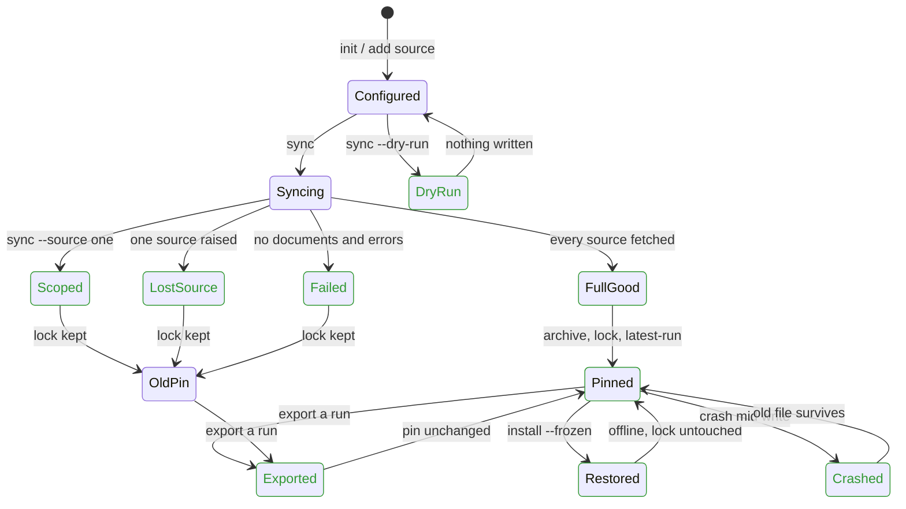

# Cache and lock flow

What a user sees from `docpull sync` to `docpull install --frozen`, and which
steps the model in `tests/test_model_cache_lock.py` found broken.

Works: full successful sync pins; frozen install is offline and read-only;
a 304 or fetch error never empties cached content (project runs fetch into a
fresh run directory, so no conditional request is sent).

Fixed (bug found, fixed, regression test in `tests/test_cache_lock_regressions.py`):

| Step | Symptom before the fix | Fix in `src/docpull/project.py` |
| --- | --- | --- |
| Dry run | `sync --dry-run` refreshed discovery over the network and rewrote `docpull.yaml`; it also rewrote the lock with no documents | skip discovery on dry run; lock only moves on success |
| Failed run | A run with no documents replaced the lock and `latest-run` | lock moves only when status is `success` |
| Crash mid write | A torn `docpull.yaml` or `context.lock.json` | write through a temp file and `os.replace` |
| Scoped sync | `sync --source a` repinned the lock to a's documents only; b's evidence vanished from the lock and frozen installs | scoped runs keep the old pin |
| Lost source | A source that raised was dropped from the lock while still listed under `sources` | runs with `source_sync_failed` keep the old pin |
| Export | `export --run old` repinned the lock to the old run; with no lock it pinned a partial run | export records itself and never changes the pinned run |

Model invariants (all hold on the fixed model, each fixed bug is re-enabled as a mutant that must fail):

1. The lock matches the cached content it points to, and its archive exists.
2. A crash never leaves the lock or config unreadable.
3. Every source named in the lock has pinned evidence.
4. Removed sources leave the lock.
5. Only complete successful runs pin the lock.
6. Failed and dry runs do not move the lock.
7. Export never repins; dry runs and frozen installs never touch config, lock or network.
8. Cached content is never emptied and runs never record content newer than upstream.
