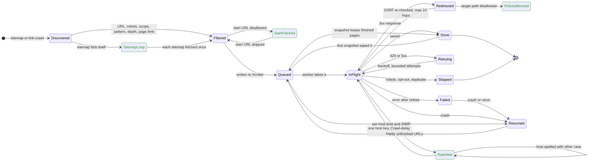

# Crawl, frontier and politeness: verified flow

Scope: discovery, frontier persistence and resume, robots, rate limits, redirects and
download limits. Models: `tests/test_model_crawl_politeness.py`. Regression tests against the
real code: `tests/test_crawl_regressions.py`.

Legend: green is **Fixed** in this change, red is **Bug found** and still open, plain is
**Works** (checked by the model and by existing tests).

## Findings

| State | Status | Detail |
| --- | --- | --- |
| Filtered, then Queued | Works | page and depth limits, dedup of normalized URLs, scope and SSRF checks |
| StartFetched | Fixed | `LinkCrawler.discover` fetched a robots-disallowed or invalid start URL for its links |
| SitemapLoop | Fixed | a sitemap index referencing itself or siblings was refetched up to depth 5 (exponential) |
| RateWait | Fixed | host keys were case sensitive, so `Docs.Example.com` and `docs.example.com` got separate concurrency slots, delays and Crawl-delay config |
| RateWait (adaptive) | Fixed | `AdaptiveRateLimiter` overwrote a robots Crawl-delay after 10 successes or a short `Retry-After` |
| Resumed, Done to Queued | Fixed | the first streaming snapshot reset pages finished before it back to queued, so resume refetched them |
| Redirected | Works | every hop is SSRF-validated, download-policy checked and capped at 10 |
| RobotsBlocked | Fixed | redirect targets were never re-checked against robots.txt; the fetcher now passes its robots check to `AsyncHttpClient.redirect_allowed` |
| Retrying | Works | attempts bounded by `max_retries + 1`, each with up to 10 redirects |

## Model invariants

| Model | States | Invariants |
| --- | --- | --- |
| Frontier, workers, crash, resume | 10,881 | no URL succeeds twice; page limit; depth limit; attempts at most 1 + crashes; completed crawl leaves nothing queued or in flight; every URL that reached disk is covered |
| Redirect chain | 29 | private target never requested; robots-denied target never requested (caught on the pre-fix model); hops bounded |
| Limiter | 105 | per-host concurrency; spacing at least the Crawl-delay |
| Sitemap walk | 11 | each sitemap fetched at most once |
