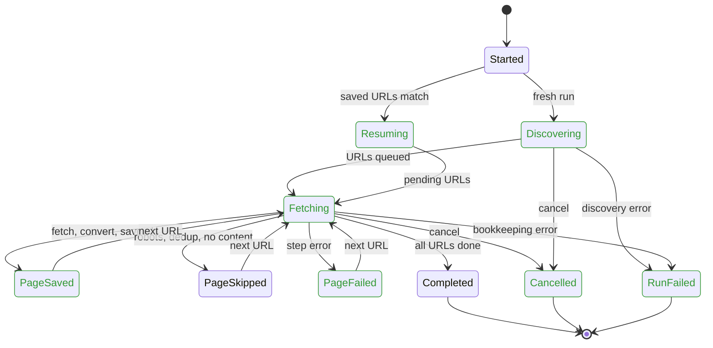

# Fetch run lifecycle

Checked by `tests/test_model_fetch_pipeline.py` (explicit-state model) and
`tests/test_fetch_lifecycle.py` (real code). Source: `core/fetcher.py`,
`pipeline/base.py`, `pipeline/steps/*`.

Colors: no color = works, red = bug found, green = fixed. Every bug
below was reproduced against real code, fixed, and is now green.

| Where | What went wrong (user-visible) | Status |
| --- | --- | --- |
| Page failed | Two FETCH_FAILED events per failed URL (fetch/save step plus pipeline) | Fixed |
| Cancel | Cancelled run wiped the resume list, so `--resume` started over | Fixed |
| Cancel | Full URL queue and workers that quit early: run hung, even past a timeout | Fixed |
| Discovery error | Run hung instead of ending with FAILED (error hid behind the timeout) | Fixed |
| Discovery error | Nothing pending: resume ran empty and never crawled the rest | Fixed |
| Resume | An error while resuming ended with no FAILED event | Fixed |
| Bookkeeping error | A cache or frontier write error killed a worker and hung the run | Fixed |
| Page saved | HTML-only page counted as saved but left pending, so resume refetched it | Fixed |

Not bugs, ruled out by test: a cancel that arrives while a worker finishes its
page (the page is recorded, then the run ends CANCELLED).

Known limit, not changed: resume after a cancel or crash mid-discovery fetches
only the URLs found so far; it does not resume discovery.

## Model

Invariants, checked over every interleaving of discovery, 1 to 2 workers, cancel,
step failures, discovery errors, and bookkeeping errors:

1. The run always terminates (no deadlock) with at most one terminal event.
2. Each failed URL has exactly one FETCH_FAILED.
3. Saved, skipped, and failed counters equal the per-URL outcomes.
4. The cache and frontier never claim a file that was not written.
5. A saved page is done in the frontier.
6. Resume keeps exactly the unfinished URLs, never a done one, and never an
   empty resume after an interrupted run.
