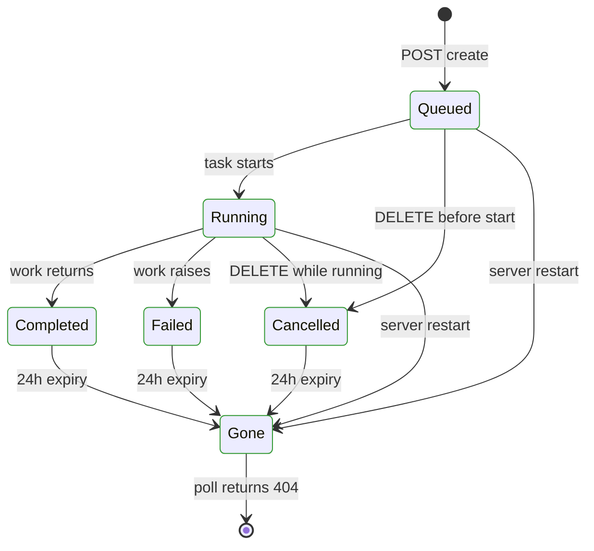
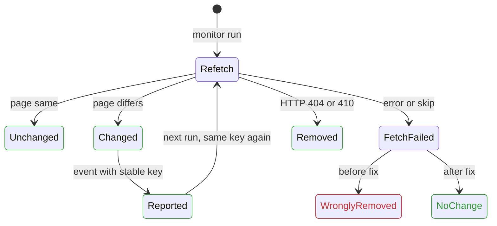
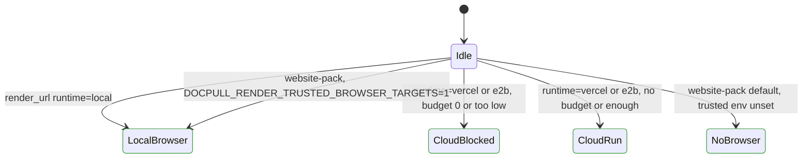

# Jobs, monitor, and agent servers

User-visible flows, with what the model and tests found.
Model: `tests/test_model_jobs_monitor.py`. Regression: `tests/test_monitor_fetch_failures.py`.

## Job lifecycle (compat server: crawl, task runs, research)

Checked: polls never go backward, terminal states never change, a cancelled job
never reports success or gains pages, only completed jobs return a result.
All hold (376 states; monitor model 996; render gate model 10). Jobs are in memory, so a restart loses them by design.

## Monitor run

Bug found and fixed: a URL that failed or was skipped during refresh was missing
from the refreshed pack, so the diff reported it as removed (`removed_count`,
`source_disappeared`, change event). Fix is in `refresh_pack`; only HTTP 404/410
still count as removed. The baseline pack never advances, so a persistent change
is reported on every run with the same idempotency key (consumers dedupe by key).

## Render and paid opt-in

Nothing starts a browser or spends money without an explicit tool argument or
env var. A cloud runtime with no `budget` argument runs uncapped; see the report.
